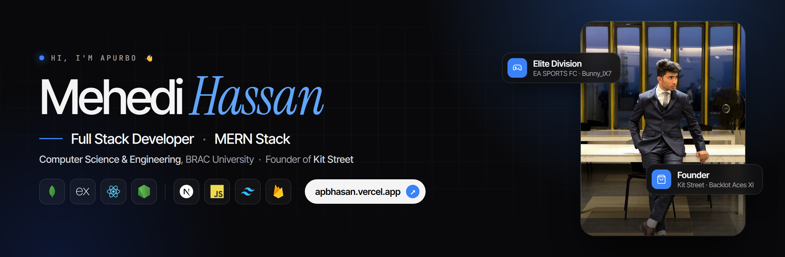

<!-- Banner -->

  

  
  
  
  
  

---

## 👋 About me

I'm **Mehedi Hassan (Apurbo)**, a **Full Stack Developer (MERN Stack)** studying **Computer Science & Engineering at BRAC University**, and the **founder of [Kit Street](https://kitstreet-bd.netlify.app)**.

I build full-stack web apps with **MongoDB, Express.js, React and Node.js**, and I like taking ideas all the way from the first design to a live product that people actually use.

- 💻 **Building with:** React, Next.js, Node.js, Express.js, MongoDB, Firebase, TypeScript, Tailwind CSS, Supabase
- 🎓 **Completed:** Complete Web Development course, Programming Hero (Batch Web-12), with a 93%+ completion score
- 🏪 **Running:** Kit Street, from the code to the customers
- 🏏 **Leading:** Backlot Aces Cricket XI, the cricket team I founded
- 🎮 **Competing:** EA SPORTS FC esports, Elite Division as **Bunny_IX7**
- 🤖 **Learning now:** Prompt Engineering and advanced React patterns
- 🌐 **Portfolio:** **[apbhasan.vercel.app](https://apbhasan.vercel.app)**

> Different arenas, the same obsession with craft, teamwork and winning the details.

---

## 🏆 Featured project

<table>
  <tr>
    <td>
      <h3>⚽ <a href="https://kitstreet-bd.netlify.app">Kit Street</a> · Wear your passion</h3>
      
A full e-commerce store for football jerseys in Bangladesh, built and run by me as a real business.

      <ul>
        <li>🛍️ <b>Shop:</b> club, national and retro kits with search, filters, half and full sleeve, sizes and custom name and number</li>
        <li>👕 <b>Team orders:</b> custom team jerseys (20+ pieces) with fabric choices and design-help requests</li>
        <li>🔐 <b>Accounts:</b> Google sign-in, order history and live order tracking</li>
        <li>📊 <b>Admin dashboard:</b> products, stock, orders, pricing, banners and sales stats</li>
        <li>🚚 <b>Automation:</b> Steadfast courier tracking and instant Telegram order alerts</li>
        <li>🛡️ <b>Security:</b> every price is checked on the server, and the database uses row-level security</li>
      </ul>
      

        
        
        
        
        
        
        
      

      
👉 <b><a href="https://kitstreet-bd.netlify.app">Visit the live store</a></b> · <i>source code is private</i>

    </td>
  </tr>
</table>

### 🚀 More projects

| Project | What it is | Built with | Links |
|---|---|---|---|
| **[Artify](https://artify-exhibition.netlify.app/)** | Artwork upload & showcase platform: galleries, favorites, login | React · Node.js · Express · MongoDB | [Live](https://artify-exhibition.netlify.app/) · [Client](https://github.com/apbhasan/new-project-a10client) · [Server](https://github.com/apbhasan/new-project-a10) |
| **[Gadget Hub](https://my-first-next-app-vent.netlify.app/)** | Premium electronics store with auth and protected dashboards | Next.js · NextAuth · Express · MongoDB | [Live](https://my-first-next-app-vent.netlify.app/) |
| **[We Make Apps](https://we-make-apps.netlify.app/)** | App showcase: trending apps, live search, sort and installation list | React · React Router · Tailwind CSS | [Live](https://we-make-apps.netlify.app/) · [Code](https://github.com/apbhasan/new-project-on) |
| **[ToyTopia](https://incredible-yeot-91b2ec.netlify.app/)** | Toy store website with category filtering | React · Tailwind CSS | [Live](https://incredible-yeot-91b2ec.netlify.app/) |

👉 See everything on my portfolio: **[apbhasan.vercel.app](https://apbhasan.vercel.app)**

---

## 🛠️ Tech stack

**Frontend** 

**Backend & database** 

**Tools & hosting** 

---

## 🤝 Let's connect

  
  
  
  
  
  
  

---

## 📊 GitHub stats

  
  

  

<b>⭐ Thanks for visiting. Let's build something great together!</b>

